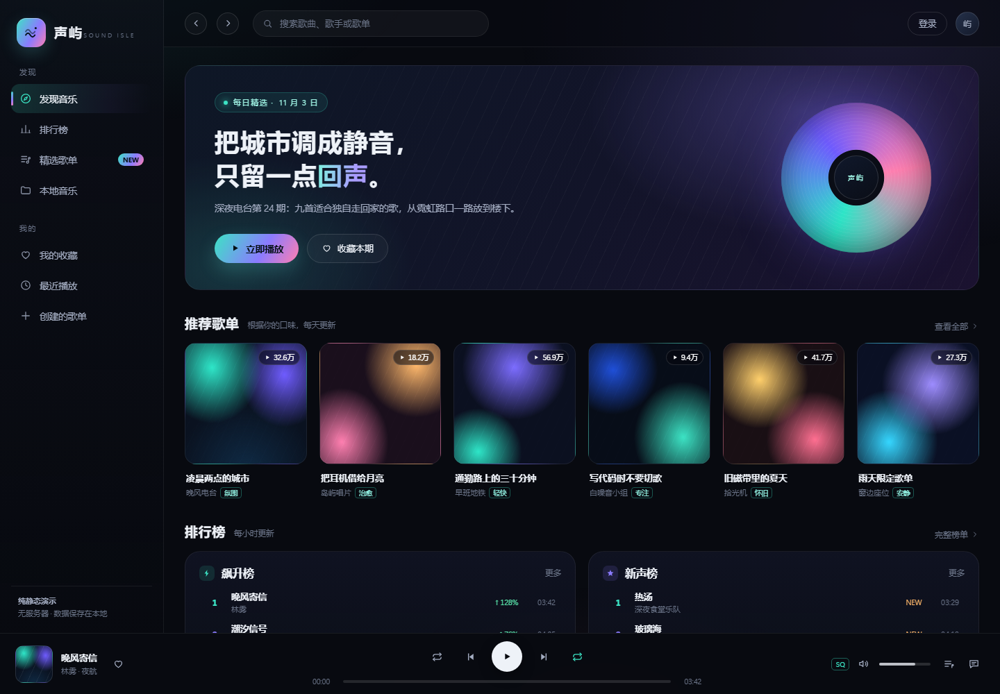
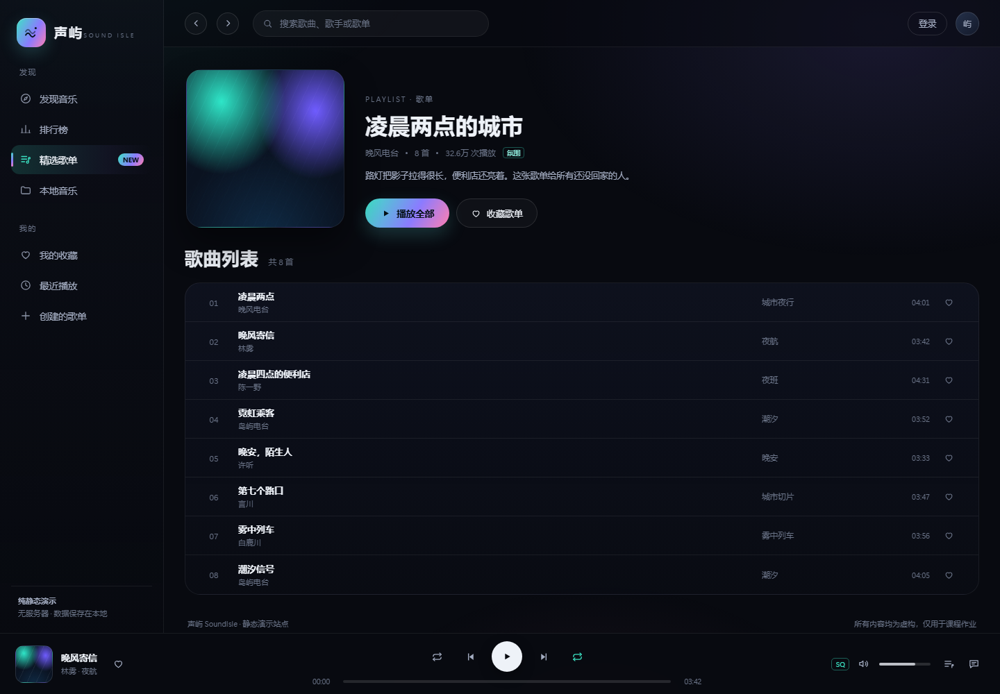
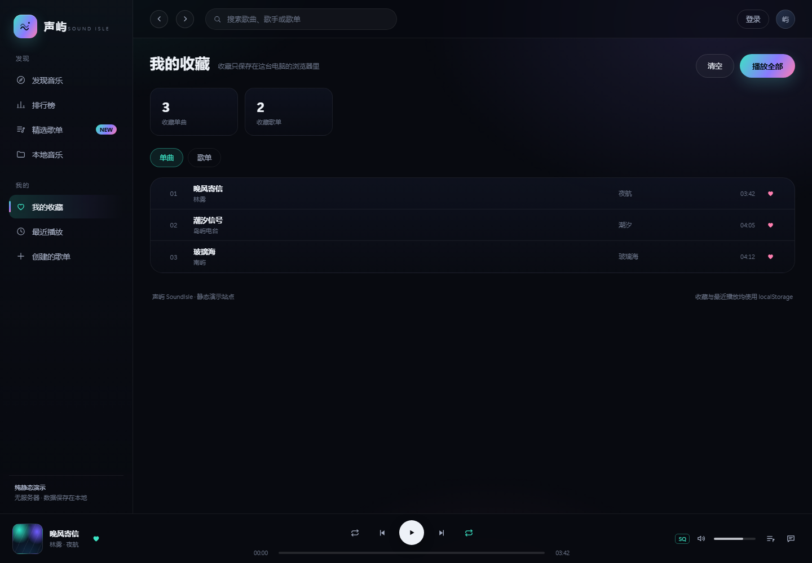

# 声屿 SoundIsle

> 一个纯静态的音乐站点演示：深色界面、自绘封面、本地播放器与收藏。
> 所有歌手、歌曲、歌单均为虚构内容，不包含任何真实平台名称、标识或素材，仅用于课程作业。

## 预览



| 歌单详情 | 我的收藏 |
| --- | --- |
|  |  |

直接用浏览器打开 `index.html` 即可（无需服务器、无需安装依赖）。
在 VS Code 里也可以右键 `index.html` → **Open with Live Server**（若安装了该插件）。

## 技术栈

- 原生 HTML + CSS + JavaScript，无框架、无构建、无 CDN
- 数据集中在 `js/data.js`，页面渲染全部在前端完成
- 封面、图标全部由 CSS 渐变与内联 SVG 生成，**零外部图片**
- 收藏、最近播放、音量等状态使用 `localStorage`

## 目录结构

```
.
├─ index.html              # 发现首页
├─ pages/
│  ├─ playlists.html       # 精选歌单
│  ├─ playlist.html        # 歌单详情（?id=p1）
│  ├─ charts.html          # 排行榜
│  ├─ favorites.html       # 我的收藏
│  ├─ recent.html          # 最近播放
│  └─ local.html           # 本地音乐
├─ css/
│  ├─ base.css             # 设计变量、重置、主题
│  ├─ layout.css           # 应用骨架：侧栏 / 顶栏 / 播放器
│  ├─ components.css       # 按钮、卡片、榜单等组件
│  ├─ home.css             # 首页首屏与响应式
│  └─ pages.css            # 内页：详情、歌曲列表、空状态
├─ js/
│  ├─ data.js              # 虚构曲库与歌单
│  ├─ common.js            # 工具、收藏、最近播放、列表组件
│  ├─ shell.js             # 公共侧栏 / 顶栏注入
│  ├─ player.js            # 底部播放器（模拟 + 本地音频）
│  ├─ home.js              # 首页
│  ├─ playlists.js         # 歌单库
│  ├─ playlist.js          # 歌单详情
│  ├─ charts.js            # 排行榜
│  ├─ favorites.js         # 我的收藏
│  ├─ recent.js            # 最近播放
│  └─ local.js             # 本地音乐
├─ 示例/                    # 立项样张与设计说明（过程留档）
└─ README.md
```

## 功能进度

| 日期 | 内容 | 状态 |
| --- | --- | --- |
| 11/3 | 视觉样张、设计规范、仓库初始化、发现首页 | ✅ |
| 11/3 | 公共外壳抽取、歌单详情、排行榜、歌单库 | ✅ 提前完成 |
| 11/3 | 我的收藏、最近播放、本地音乐导入 | ✅ 提前完成 |
| 11/4 | 搜索页（歌曲 / 歌手 / 歌单分类结果） | ⏳ |
| 11/5 | 歌手页、专辑页 | ⏳ |
| 11/6 | 播放器增强：歌词滚动、播放队列面板 | ⏳ |
| 11/7 | 创建歌单（本地编辑）、批量操作 | ⏳ |
| 11/8 | 浅色主题、响应式细化、空状态与错误态 | ⏳ |
| 11/9 | 自测、文档、打 tag 发布 | ⏳ |

## 已实现

- **首页**：每日推荐首屏、推荐歌单网格、双榜单
- **歌单详情**：封面、作者、播放量、简介、歌曲列表、整单播放、收藏歌单
- **排行榜**：飙升榜 / 新声榜，趋势标记，整榜播放
- **我的收藏**：单曲 / 歌单两个分页签，播放、取消收藏、清空
- **最近播放**：自动记录最近 30 首，可清空
- **本地音乐**：拖拽或选择本地音频，`URL.createObjectURL` 真实播放，文件不出本机
- **播放器**：播放 / 暂停 / 上一首 / 下一首 / 随机 / 进度拖动 / 音量 / 收藏
- **导航**：侧栏与顶栏在页面间复用，当前页高亮，支持前进后退

## 说明

- 站点中出现的「声屿 / SoundIsle」为原创虚构品牌
- 页面底部标注了「内容均为虚构，仅用于课程作业」
- 本地音乐的文件不会被上传或写入磁盘，刷新页面后需要重新导入
- 收藏与播放记录只保存在当前浏览器，换浏览器或清缓存会丢失
